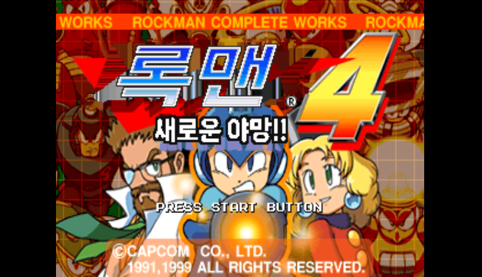
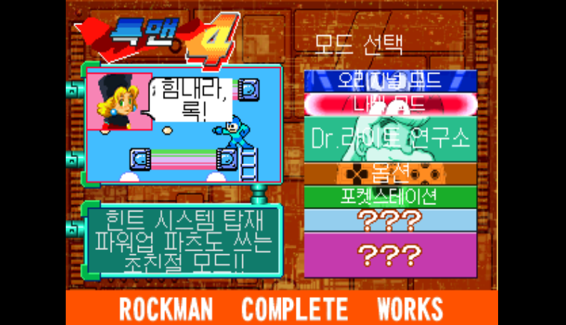
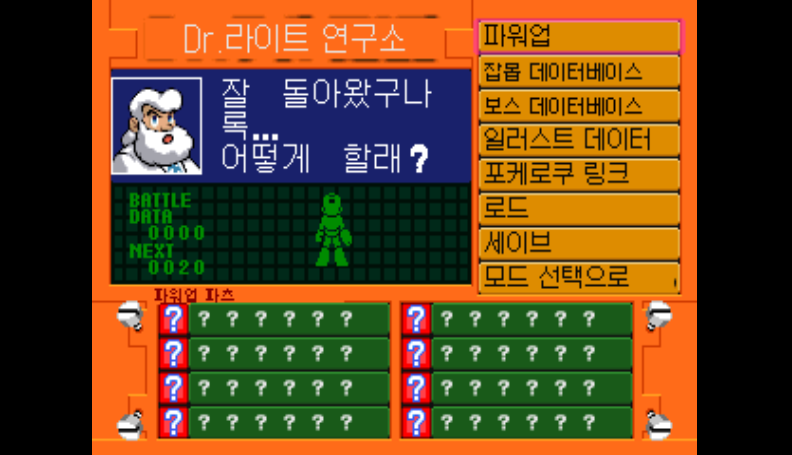
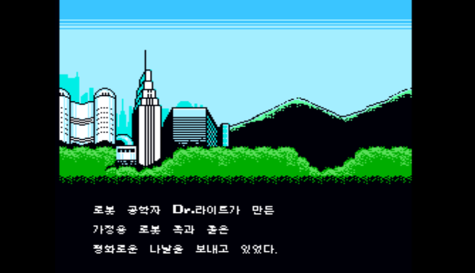

# 록맨4 새로운 야망!! (록맨 컴플리트 웍스) 한글 패치

PlayStation용 **『ロックマン4 新たなる野望!!』(SLPS-02324, 록맨 컴플리트 웍스, 1999)**의
비공식 한국어 번역 패치입니다.

**메뉴·대사·도감·힌트·그래픽 글자까지 게임 안의 일본어를 모두 한국어로 바꿨습니다.**

| 항목 | 내용 |
|---|---|
| 나비 모드 칼린카 힌트 | **124 / 124** |
| Dr.라이트 연구소 대사 | **19 / 19** |
| 잡몹·보스 데이터베이스 | **69종 이름 + 59개 설명** |
| 메모리카드·포켓스테이션 메시지 | 약 140개 전부 |
| 무기 화면 설명 | **15 / 15** |
| 다시 그린 그래픽 | 메뉴·라벨·일러스트·로고 약 130장 |
| 본편(NES) 오프닝·이벤트 대화 | 오프닝 7페이지 + 「AD 200X년」 + 칼린카·코사크·와일리 대화 10페이지 |
| 폰트에 넣은 한글 | 545자 (최대 약 1,000자 수용) |






---

## 1. 패치 적용 방법

### 준비물

- **원본 디스크 이미지** — `Rockman 4 - Aratanaru Yabou!! (Japan)` (Redump, 단일 BIN/CUE)
- **xdelta3** — 릴리즈에 포함된 `xdelta.exe` 또는 [Delta Patcher](https://github.com/marco-calautti/DeltaPatcher/releases)

### 원본 확인

```
파일   Rockman 4 - Aratanaru Yabou!! (Japan).bin
크기   620,591,664 바이트
MD5    74B1A2AE8D8776F1B15D0B6FDE9C2F79
SHA-1  C81935577267C12EE6BD939FF2D04C063D6568CA
```

```powershell
Get-FileHash -Algorithm MD5 "Rockman 4 - Aratanaru Yabou!! (Japan).bin"
```

### 적용

```bash
xdelta.exe -d -s "Rockman 4 - Aratanaru Yabou!! (Japan).bin" Rockman4_CompleteWorks_Korean.xdelta "Rockman 4 - Aratanaru Yabou!! (Korean).bin"
```

### 결과 확인

```
파일   Rockman 4 - Aratanaru Yabou!! (Korean).bin
크기   620,591,664 바이트
MD5    5A0845B0F4FA7D3B4D4BA16ADA90F7A1
SHA-1  8B6E2736D4207623F17CE56F7A95248265727116
```

### 실행

릴리즈의 `.cue`를 패치된 `.bin`과 같은 폴더에 두고 에뮬레이터로 여세요.
DuckStation에서 확인했습니다.

> GitHub가 첨부 파일명의 공백·괄호를 점으로 바꿀 수 있습니다. `.cue` 안의 `FILE` 줄과
> 실제 `.bin` 파일명이 같기만 하면 됩니다.

---

## 2. 번역 범위

- 시작 경고 화면(칠판), 부팅 메모리카드 메시지
- PS1 타이틀·로딩·모드 선택 로고(「록맨」「새로운 야망!!」)
- 모드 선택·옵션·버튼 설정·미션 모드·사운드 룸 메뉴 그래픽
- Dr.라이트 연구소 대사, 파워업 파츠, 잡몹/보스 데이터베이스
- 일러스트 데이터(록맨·코사크·칼린카 프로필, 성 이름, 축하 메시지)
- 나비 모드 칼린카 힌트, 일시정지 메뉴, 무기 이름
- 세이브/로드·패스워드·메모리카드·포켓스테이션 메시지
- 본편(NES) 오프닝 스토리와 연도 화면

남은 것:

- **본편(NES) 타이틀 로고의 부제(新たなる野望!!)** — 로고 그림과 타일을 공유해 깨끗이
  바꿀 수 없어 원본을 유지했습니다.
- 손글씨 만화 일러스트, 영어 표기(ROCKMAN COMPLETE WORKS 등)

---

## 3. 기술 메모

```
DATA.PAC          49개 항목 (sector, size) 테이블
  #03             시스템 폰트 TIM 256x256 4bpp, 16x16 셀 256자
  #12 / #17 / #18 연구소·나비 대사, 메모리카드 메시지, 변환 루틴 오버레이
  #00             부팅 오버레이 (RLE 타입2, 경고 TIM이 한 번 더 압축되어 내장)
  #22             NES ROM (오프닝 텍스트 0x378D5~)
SLPS_023.24       글리프 셀 계산 함수 0x8004209C
```

- 폰트 확장: 4bpp 셀을 **1비트 4평면**으로 쪼개 CLUT 행으로 평면을 고르게 했습니다.
  바이트 문자열은 `F1~F3` 접두 2바이트, 16비트 문자열은 상위 바이트가 평면 번호입니다.
- 변환 루틴(EXE·#12·#18)을 MIPS로 패치했고, 나비 대사는 블록을 다시 채워 포인터 125개를
  재배치했습니다.
- 부팅 오버레이 RLE 코덱을 해독해 원래 크기 안에서 재압축합니다.

## 4. 소스에서 빌드하기

Windows 기본 C# 컴파일러(`csc.exe`, .NET Framework 4)만 있으면 됩니다.

```powershell
cd tools
csc /optimize /r:System.Drawing.dll /out:build.exe build.cs mips.cs extra.cs sysf_lib.cs rle.cs
csc /optimize /out:disc.exe disc.cs
```

`tools/iso.cs`·`pac.cs`로 원본에서 `SLPS_023.24`·`DATA.PAC`를 추출한 뒤 `build.exe`,
`disc.exe 원본.bin 결과.bin` 순으로 실행합니다. 번역문은 `translation/*.tsv`에 있습니다.

## 5. 라이선스와 고지

- 도구·번역문·문서: [MIT License](LICENSE)
- [갈무리체](https://galmuri.quiple.dev/) © Lee Minseo, SIL OFL 1.1 — [`fonts/Galmuri-OFL.txt`](fonts/Galmuri-OFL.txt)
- 로고 글자: 나눔스퀘어 네오 © NAVER, SIL OFL 1.1
- 게임의 저작권은 **株式会社カプコン**에 있습니다. 이 저장소에는 게임 데이터가 없으며,
  `.xdelta`는 원본 대비 차분일 뿐입니다. 정품에서 직접 덤프한 이미지를 사용하세요.

이 패치는 팬 번역이며 권리자와 무관합니다.
